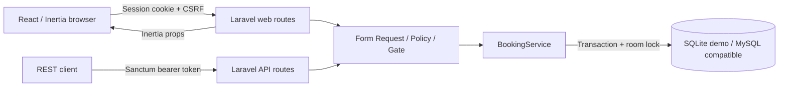
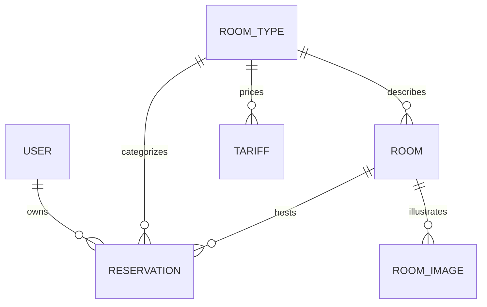
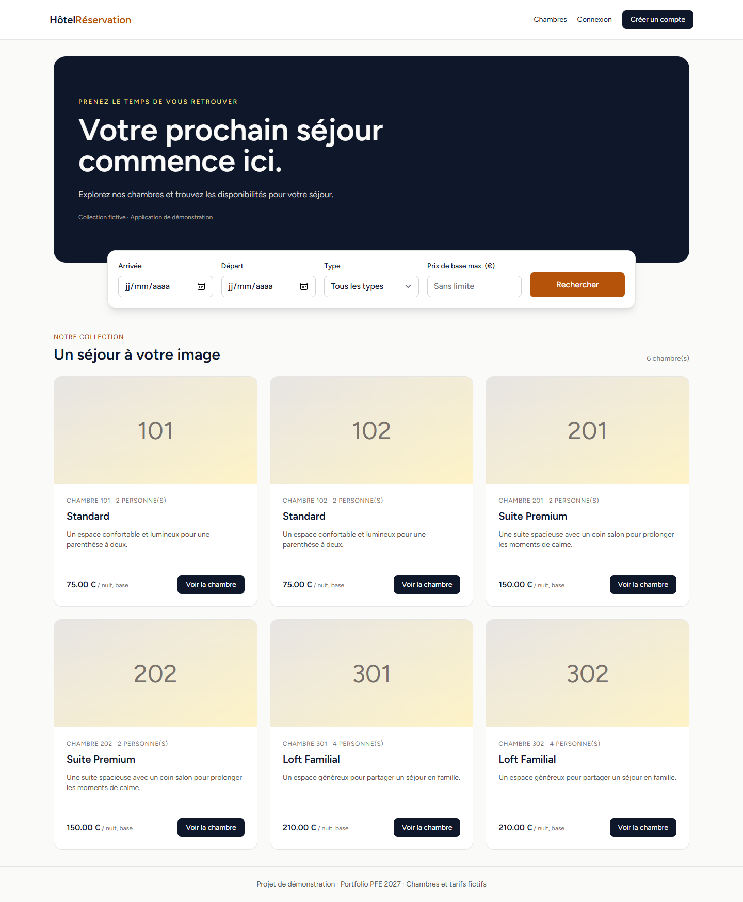

# Hotel Reservation

A full-stack hotel booking portfolio project for PFE 2027 applications. Built with Laravel, React and Inertia, it demonstrates server-side booking rules, REST endpoints, authentication, authorization and automated verification.

## Project Overview

The application lets visitors explore a fictional room collection and search availability. Registered guests can book a physical room, review their reservations and cancel before arrival. Administrators can manage inventory through protected REST endpoints and handle arrivals/departures through the management page.

This is a demonstration: room descriptions and prices are fictional, and no payments are collected.

## Main Features

- Responsive room catalogue, room types, capacities, existing room images and galleries.
- Search by dates, room type and maximum **base** nightly price.
- Server-calculated nightly pricing, seasonal tariffs and booking confirmation.
- Personal reservation history and cancellation before the arrival date.
- Atomic reservation transitions and protected administrator operations.
- Session authentication for the website; Sanctum bearer tokens for API clients.
- Repeat-request protection and concurrent booking protection.

## Tech Stack

| Layer | Technology |
| --- | --- |
| Runtime | PHP 8.2+, Node.js 24 LTS recommended |
| Backend | Laravel 12, Sanctum 4, Inertia Laravel 2, Ziggy 2 |
| Interface | React 19, Inertia React 2, Tailwind CSS 3 |
| Build | Vite 8, PostCSS, npm lockfile |
| Demo / tests | SQLite, PHPUnit 11, Playwright with Edge locally |
| Quality | Laravel Pint, ESLint 9, GitHub Actions |

Exact resolved versions are recorded in the lockfiles. The audited implementation uses Laravel 12.72.0, Sanctum 4.4.0, Inertia Laravel 2.0.28 and Vite 8.3.8.

## System Architecture



The existing React/Inertia application is retained. The separate `frontend/` directory is an unused Vite prototype, preserved without creating a competing SPA. See [Architecture](docs/ARCHITECTURE.md).

## Backend and Frontend Structure

```text
hotel-reservation/backend/
  app/Http/Controllers/   Web and REST controllers
  app/Http/Requests/      Booking input validation
  app/Policies/          Reservation ownership
  app/Services/          Booking, pricing and transitions
  database/              Versioned migrations and demo fixtures
  resources/js/          Active React pages and layouts
  resources/css/         Tailwind entry point
  tests/                 PHPUnit, process concurrency and browser tests
  scripts/               Isolated demo launchers
hotel-reservation/frontend/   Preserved inactive Vite prototype
docs/                         Architecture, security, testing and screenshots
```

## API Endpoints

All paths below have the `/api` prefix. Send `Accept: application/json`.

| Method | Path | Access / behavior |
| --- | --- | --- |
| POST | /login | Public; rate limited; returns a bearer token |
| POST | /logout | Token holder; revokes the current token |
| GET | /reservations/check-availability | Public; check_in and check_out; returns physical rooms |
| GET | /reservations | Authenticated; current user's reservations |
| POST | /reservations | Authenticated; creates or returns an identical repeated booking |
| POST | /reservations/{id}/cancel | Owner; confirmed booking before arrival |
| POST | /reservations/{id}/check-in | Administrator; confirmed booking during its stay |
| POST | /reservations/{id}/check-out | Administrator; checked-in booking |
| GET, POST | /rooms, /room-types, /tariffs | Administrator resource lists / creation |
| GET, PUT/PATCH, DELETE | /rooms/{id}, /room-types/{id}, /tariffs/{id} | Administrator resource operations |

Booking payload: `room_id`, `guest_name`, `check_in`, `check_out`, `guests`, `request_key` (UUID). Client-supplied price, owner and status are ignored. An identical retry with the same key returns the same reservation (HTTP 201); changing the payload with that key returns 409.

Web routes include `/`, `/chambres/{id}`, `/profile/reservations`, `/reservations/{id}/confirmation` and `/admin/reservations`. Browser mutations use Laravel's CSRF-protected web routes.

## Authentication and Security

Breeze supplies registration, login, password reset, profile and password management. Guests cannot grant themselves administrator privileges: `is_admin` defaults to false and is excluded from mass assignment. Administrator promotion is an explicit operator task, outside public forms.

Reservation Policies enforce ownership; a Gate protects all management endpoints. Debug routes and exception-detail responses were removed. Production-style configuration disables debugging. Sanctum tokens expire after seven days. See [Security](docs/SECURITY.md).

## Booking and Availability Logic

Stays use half-open intervals `[check_in, check_out)`. Two active bookings overlap exactly when:

```text
existing.check_in < requested.check_out
AND existing.check_out > requested.check_in
```

Only `confirmed` and `checked_in` reservations block their physical room. Adjacent stays are allowed; rooms of the same type remain independent.

A transaction locks the room before availability is checked. Its first operation writes the room row, also serializing SQLite writers. Deadlock/concurrency retries are bounded. Pricing iterates each night: the matching tariff with the highest ID wins; otherwise the room type's base price applies. Tariff start/end dates are inclusive. Amounts use integer cents and BCMath, then persist as DECIMAL(8,2); inputs allow at most two decimal places. No binary floating-point arithmetic is used to calculate booking totals.

The UI labels its base-price estimate; the definitive seasonal total appears on confirmation. Cancellation is allowed only while confirmed and before the arrival day. Check-in is allowed from arrival through the day before departure. Check-out requires check-in; early checkout is allowed. Invalid/repeated transitions return 409.

## Database Schema



The new migration adds the administrator flag, guest count, a unique nullable request key and a composite availability index. Existing migration history is retained. Legacy nullable room IDs require review before importing old bookings; see [Architecture](docs/ARCHITECTURE.md).

## Screenshots

Actual captures from the running isolated demo, taken with Playwright/Edge:



| Screen | Capture |
| --- | --- |
| Mobile catalogue | [390 px](docs/screenshots/home-390.png) |
| Small mobile | [320 px](docs/screenshots/home-320.png) |
| Tablet | [768 px](docs/screenshots/home-768.png) |
| Availability search | [View](docs/screenshots/availability.png) |
| Booking form | [View](docs/screenshots/booking-form.png) |
| Confirmation | [View](docs/screenshots/confirmation.png) |
| Personal reservations | [View](docs/screenshots/my-reservations.png) |

No generated interface mockups or official hotel photography are used.

## Requirements

- PHP 8.2+ with BCMath, PDO SQLite, mbstring, XML, cURL and normal Laravel extensions.
- Composer 2.
- Node.js 24 LTS and npm.
- Edge for the local browser test, or Playwright Chromium in CI.

## Local Installation

From the repository root:

```sh
cd hotel-reservation/backend
composer install
npm ci
npm run build
```

On PowerShell, use `npm.cmd` / `npx.cmd` if script execution policy blocks the shell wrappers. A restricted environment may need a writable local npm cache: `npm ci --cache ../../.npm-cache`.

## Environment Configuration

For a conventional personal development setup, copy `.env.example` to a new `.env` and run `php artisan key:generate`. Never overwrite an existing environment file. Configure a newly created development database before running any migration.

The recommended demo launcher sets a random application key, a newly created uniquely named SQLite database, file sessions, synchronous queues and debugging disabled. It does not use or modify an existing database. No real credentials are needed.

For production planning, use HTTPS, `APP_DEBUG=false`, secure cookies, appropriately protected database credentials and a real mail provider. This mission does not deploy production infrastructure.

## Running the Application

```sh
# From backend; creates and migrates a NEW disposable SQLite database
php scripts/demo.php
```

Open http://127.0.0.1:8000 and register a fictional account. Optional port: `php scripts/demo.php 8001`. A PowerShell alternative is `./scripts/demo.ps1`.

For frontend development, use `npm run dev` in a second terminal. Remove its `public/hot` marker by stopping Vite before serving a built demo. The demo data contains six rooms and no default user or administrator password.

## Running Tests

```sh
php vendor/bin/phpunit
php tests/Concurrency/booking-race.php
php vendor/bin/pint --test
composer validate --strict
composer audit
npm run lint
npm run build
npm audit
# With a fresh isolated demo running:
npx playwright test
```

PHPUnit forcibly uses SQLite `:memory:`; its base TestCase refuses other databases before RefreshDatabase can run. The separate concurrency test creates its own temporary SQLite file. Browser tests create fictional accounts and cancel their test booking. See [Testing](docs/TESTING.md) for exact executed results and limitations.

## Known Limitations

- MySQL concurrency has not been executed; the verified database is SQLite.
- No payment gateway, email booking receipt, refunds or deployment.
- Catalogue price filtering uses base prices, not a per-stay seasonal quote.
- Base estimates may differ from seasonal totals; confirmation gives the authoritative total.
- Inventory CRUD is API-based; the administrator page focuses on reservations and arrivals/departures.
- Legacy schemas use cascading foreign keys. Controller protections preserve room history, but direct database writes require operator care.
- Email verification is scaffolded by Breeze; the User model does not enforce MustVerifyEmail.
- The preserved standalone frontend and legacy seeders are not the supported application entry points.

## Future Improvements

Add a pre-confirmation seasonal quote, a MySQL concurrency CI job, pagination for large catalogues, email receipts, richer inventory management screens and database-level historical retention constraints.

Further reading: [Architecture](docs/ARCHITECTURE.md), [Testing](docs/TESTING.md), [Security](docs/SECURITY.md), [Final report](docs/FINAL_REPORT.md), [GitHub presentation](docs/GITHUB_PRESENTATION.md).
